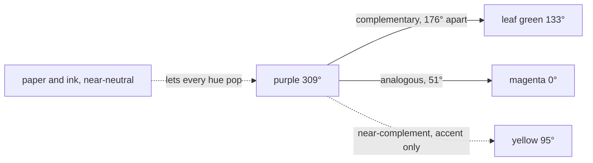
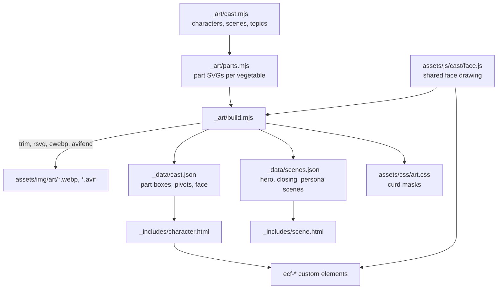
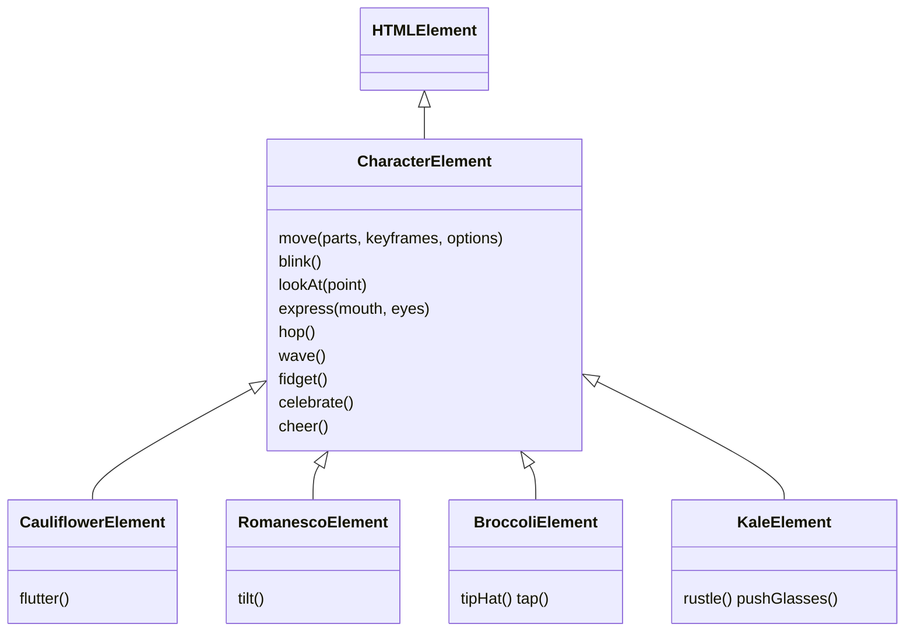
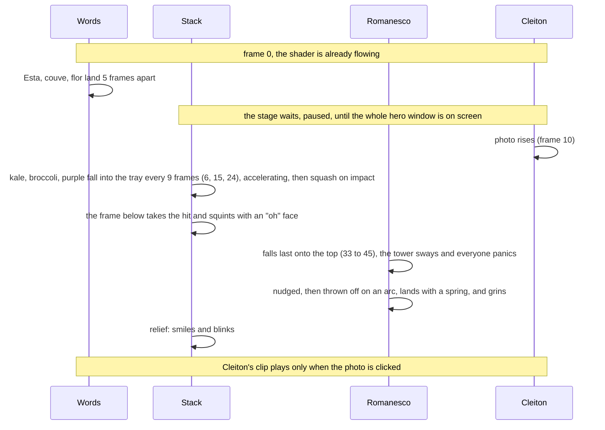

# Design system

How the site looks, moves and draws its cast. Tokens live in `assets/css/tokens.css`; this file holds the reasoning.

## Color

The page palette comes from the career trace card in the GitHub profile (`klaygomes/klaygomes`, `assets/trace-card.svg`): a warm, near-neutral engineering figure. Brand hues are placed by their OKLCH hue, so the relationships are measurable rather than eyeballed.

| Token | Hex | OKLCH hue | Role |
|---|---|---|---|
| `paper-50` | `#FBFAF7` | warm neutral | page surface |
| `ink-900` | `#1F1A24` | violet-tinted neutral | text |
| `rule-200` | `#E6E2DA` | warm neutral | hairlines, card outlines |
| `gray-500` | `#9A94A1` | neutral | muted text |
| `lilac-100` | `#EEE6F5` | 311° | tinted sections (post headers, archive) |
| `purple-900` / `purple-700` | `#480F7B` / `#7E23B3` | 301° / 309° | nav, footer, links, markers |
| `yellow-400` | `#FAD30B` | 95° | the one highlight |
| `magenta-500` | `#C63F75` | 0° | wordmark and shader only |
| `green-800` | `#3E6B0F` | 133° | wordmark and leaves |

- **60 / 30 / 10.** Paper and ink are the 60%. Lilac tints, hairlines and muted text are the 30%. Purple accents and a single yellow highlight (the stack bars, sparkles, footer type) are the 10%.
- **Joy lives in the cast and the field.** The neutral ground makes the vegetables and the viscous shader (magenta, deep purple, lilac glints) the only saturated things on the page. Each `[data-shader]` surface can override `--shader-1..3`; the newest-post card uses a darker trio so its yellow headline stays readable.
- **The cauliflower pops by itself.** Its leaf green sits almost exactly opposite the brand purple.
- **The cast is one family.** Each vegetable keeps its real hue, but its gradient runs between two neighbours on the wheel and all of them share a lightness band (L 0.6 to 0.9, C 0.13 to 0.2).

| Persona | Topic | Gradient | Prop |
|---|---|---|---|
| couveflor (lead) | home, about | cream 92° to 72°, leaves 133° | none, sleepy logo face |
| romanesco | Low-level | chartreuse 124° to yellow 95° | STM32 chip |
| roxa (purple cauliflower) | Frontend | purple 309° to magenta 355° | React atom |
| brócolis | Tooling | green 145° to teal 185° | hard hat, wrench |
| couve (kale) | .NET | teal 172° to blue 236° | retro glasses |

No chips or pills anywhere, and no dotted backgrounds. Grain appears only inside shader surfaces.

## Organic shapes

The cauliflower curd is the shape language. `_art/edges.mjs` generates three masks as CSS tokens in `assets/css/art.css`:

- `--curd-edge`: a repeating bump tile, used by `.curd` seams between sections (set its color with a `text-*` class).
- `--curd-mask-side` and `--curd-mask-band`: the hero window's bumpy left edge on desktop and its bumpy top and bottom on phones.

Hand-drawn double marker strokes underline key words (`.hero-marker`).

## The cast

Characters are drawn by code and cut into parts at build time, then rigged in the browser as custom elements, so every part can move on its own.

Run `npm run art` after changing anything in `_art/` and commit the output. It needs `rsvg-convert`, `cwebp` and `avifenc` (Homebrew `librsvg`, `webp`, `libavif`).

### Parts

Each character is a stack of textured parts (`stem`, `head`, `leaf-left`, `leaf-right`, `arm`, `prop`, `hat`) plus a live vector face. Parts are trimmed to their own boxes and placed by percentage inside a 480-unit frame. Each part's `transform-origin` is its pivot, so a leaf rotates from its base and an arm from its shoulder. Parts that move together (an arm and the prop it holds, a head and its face) share one pivot, so the same keyframes keep them aligned.

### Components

- The base class (`assets/js/cast/character.js`) owns the idle loop (breathing, random blinks and fidgets), eyes that follow the pointer, a tap to cheer, and pausing when off screen.
- A new vegetable needs a body in `_art/parts.mjs`, an entry in `_art/cast.mjs`, and a subclass in `assets/js/cast/kinds.js` that overrides `fidget()` and `celebrate()`. The tag is `ecf-<kind>`.
- Liquid renders the full rig on the server, so characters show up without JavaScript; the elements only add motion.
- `` renders a rig; add `flat=true` for a single small image (topic links).

## Motion

Motion is physical: things fall under gravity, and everything that settles does so on a simulated damped spring, so arrivals overshoot and wobble instead of easing to a stop.

- `assets/js/spring.js` solves the damped harmonic oscillator for four presets and samples each into a CSS `linear()` easing plus its settle time. The build writes them as `--spring-gentle`, `--spring-bouncy`, `--spring-wobbly`, `--spring-snappy` (and `-duration`) into `assets/css/art.css`; the components import the same presets.
- Gestures are impulses: a part is displaced (an arm raised, a leaf bent, a hat lifted) and released into a spring, so a wave or a flutter oscillates and settles by itself.
- The romanesco's overflow is simulated in `assets/js/overflow.js`: a gravity fall onto the computed top of the stack, a spring squash, a nudge, a ballistic arc (constant drift sideways, gravity downwards, tilting toward the throw) and a spring landing, sampled at 60 fps into keyframes and synced to the CSS timeline. It turns about its own centre; squashes stay anchored at its feet.
- The stack reacts: the frame below takes each hit with an "oh" face; when the romanesco lands on top the tower sways (more the higher the level), everyone panics with worried brows and a wavy mouth and trembles until it lands, then they blink with relief.

| Spring | Stiffness / damping | Use |
|---|---|---|
| gentle | 120 / 15 | text, photo, cards entering |
| bouncy | 210 / 13 | landings, peeks, riders, hat tips |
| wobbly | 190 / 8 | waves, flutters, sways, take-hit |
| snappy | 420 / 30 | eyes following the pointer, card hover |

- Choreography is CSS and runs only with `.js` and no `.motion-off`, so content is never hidden otherwise.
- `prefers-reduced-motion` and the hero's "Pause motion" button (stored as `ecf-motion` in localStorage) stop the shader, the idle loops and every entrance.
- On phones the hero window sits below the copy, so `.hero-window.is-waiting` pauses the stage animations at their first frame and `site.js` releases them once the window is fully in view under the sticky header.
- Cleiton's two clips (the hero photo and the footer "idea") are easter eggs: they play only on click, never on their own. Each clip is fetched once its button is near view (or on first hover, focus or touch on slow or Save-Data connections), and a tap squashes the button and shows thinking dots until the video plays.
- The closing riders wait under the wave and rise when the footer's last row is in view, then cheer one after another.

## Hero field

`assets/js/viscous-shader.js` is a WebGL2 fluid simulation that the pointer stirs, ported from the Guia do Crédito theme. It runs on every `[data-shader]` surface (the hero window and the newest-post card), each with its own `.shader-canvas`, and pauses when that surface leaves the screen. It reads its three colors from `--shader-1..3`, drops to a cheaper mesh when frames run long, and falls back to drifting CSS gradients without WebGL.
